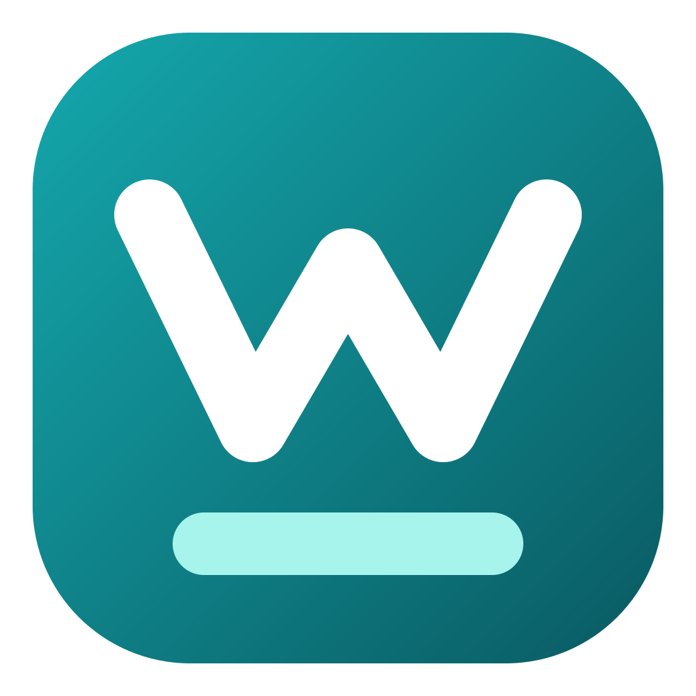
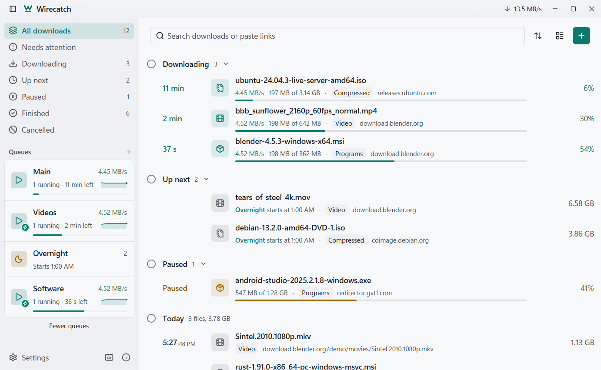
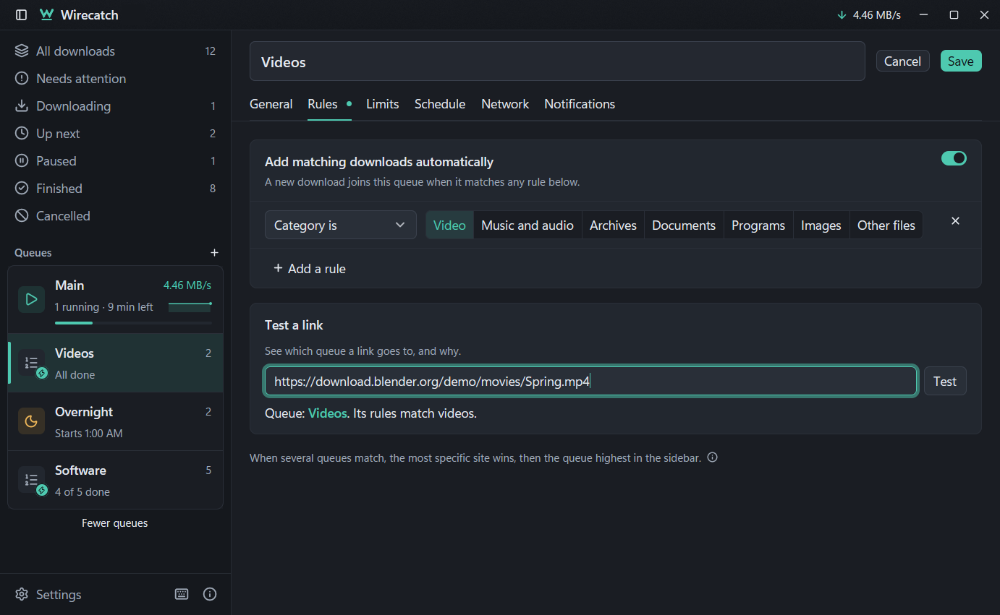
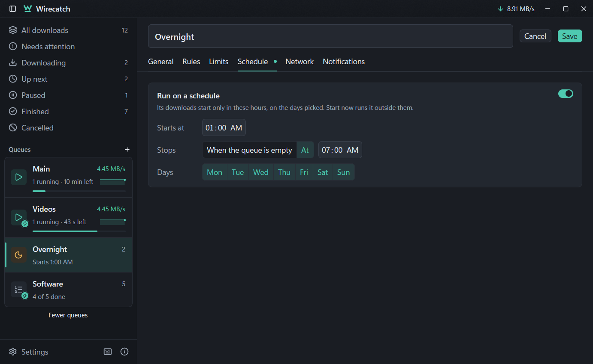

<p align="center">
  
</p>

<h1 align="center">Wirecatch</h1>

<p align="center">
  <strong>A free, open-source download manager for Windows and Linux.</strong><br />
  Parallel downloads, capture from your browser, HLS and DASH streams, and video sites through an optional add-on.
</p>

<p align="center">
  <a href="LICENSE"></a>
  
  
  <a href="https://github.com/ehsan18t/wirecatch-oss-dm/actions/workflows/ci.yml"></a>
</p>

<p align="center">
  <a href="#highlights">Highlights</a> ·
  <a href="#features">Features</a> ·
  <a href="#how-it-compares">How it compares</a> ·
  <a href="#command-line">Command line</a> ·
  <a href="#privacy-and-security">Privacy</a> ·
  <a href="#get-wirecatch">Get Wirecatch</a>
</p>

<picture>
  <source media="(prefers-color-scheme: dark)" srcset="docs/images/main-window-dark.png" />
  
</picture>

## Highlights

- **Resume that checks the file.** Downloads continue after a restart, crash or power cut. If the file changed on the server, Wirecatch starts over instead of joining two different files.
- **Expired links keep their progress.** Give a download a new link, or catch it again from the browser, and it continues from where it stopped, even when the new link is a stream instead of a file.
- **Queues that sort themselves.** Rules send each new download to a queue by site, file name, type or protocol. Each queue can have its own schedule, speed limit, folder and proxy.
- **Video without a second app.** HLS and DASH streams are built in. An optional add-on, installed in one click, adds YouTube, Vimeo, TikTok and other sites, with conversion, subtitles and chapters.
- **Errors that come with their fix.** A failed download says what went wrong in plain words and offers the matching action as a button.
- **Private by design.** No account and no telemetry. The browser reaches the app without a network port, and downloads from private windows leave no history, logs or files behind.

## Features

<details>
<summary><strong>Downloads</strong>: parallel connections, resume, refresh expired links, FTP and HTTP/3</summary>

- 8 connections per file by default, up to 32 in the app and 64 on the command line. Remaining parts move to whichever connection is free, so one slow connection does not hold up the end.
- Downloads and streams from the same site share one pace: they honour `Retry-After`, step back when a server limits connections, and show when they are waiting or reconnecting.
- Partial files stay hidden until the download is complete.
- Move a download to another folder while it runs, without replacing a file already there.
- Each download keeps a history in Details: failures with their message, retries, pauses, new links and moves.
- The download list is repaired at start if its database was damaged.
- HTTP, HTTPS, FTP and FTPS (`ftps://` and `ftpes://`), and experimental HTTP/3.

</details>

<details>
<summary><strong>Browser extension</strong>: Chrome, Edge, Brave, Vivaldi, Opera, Arc and Firefox</summary>

- Takes over browser downloads with the cookies and referrer the browser would send, so downloads behind a sign-in work. A captured download is never lost or downloaded twice.
- **Download with Wirecatch** in the right-click menu, a download button over videos on the page, and a keyboard shortcut for the page's media.
- The toolbar popup lists the streams and video files found on the current tab.
- Choose what is captured: ignore sites, capture only listed file types, skip small files, and pick the default queue.
- Files the browser flags as dangerous stay in the browser, and the Windows Mark of the Web stays on the file.
- A window for each download to rename it, change its folder, pick its queue or video quality, and follow its progress. Or skip the window and start with a notice.
- Clicking a notice opens that download in the app.
- Settings live in the desktop app and apply to every connected browser.

</details>

<details>
<summary><strong>Video, audio and streams</strong>: HLS and DASH, video sites, conversion and subtitles</summary>

- HLS (encrypted streams included) and DASH, downloaded in parallel and joined without re-encoding.
- The optional Media add-on (`yt-dlp`, `ffmpeg` and `Deno`) installs in one click and covers YouTube, Vimeo, TikTok and extra sites you add.
- Paste a video page's link into the app and Wirecatch finds the video on it.
- Sites that check for a real browser are read through your connected browser, and site scripts run in Deno. The video itself still downloads over parallel connections.
- Keep the original format, or save video as MP4, MKV or WebM and audio as MP3, M4A, Opus, FLAC or WAV.
- Embed subtitles or save them as `.srt`, with auto-generated subtitles, chapters and audio cover art as options.
- Hardware encoding when a conversion is needed, and the original file is kept if conversion fails.
- A preferred resolution and format, with a fallback to the next lower or higher quality.

</details>

<details>
<summary><strong>Queues, rules and schedules</strong>: per-queue limits, folders, proxies and auto-routing</summary>

- Each queue uses the app's defaults or its own downloads at once, connections per download, speed limit, folder, proxy and finish notification.
- Rules assign new downloads to a queue by site, file name or regular expression, file type or protocol. **Test a link** shows where a link will go.
- Schedules with a start time, an optional stop time and days of the week, plus **Start now** and per-queue pause.
- Drag downloads between queues or reorder them. A waiting download says why it has not started.

<table>
  <tr>
    <td></td>
    <td></td>
  </tr>
</table>

</details>

<details>
<summary><strong>Proxies and network</strong>: proxy profiles per queue, local network protection</summary>

- The system proxy, no proxy, or named HTTP, HTTPS, SOCKS4, SOCKS4a, SOCKS5 and SOCKS5h profiles, for the whole app or per queue.
- Copy the system proxy, test a profile, and set host exceptions globally or per queue.
- Links on public web pages cannot reach devices on your local network, such as a router or NAS, unless you allow that site.

</details>

<details>
<summary><strong>Desktop app</strong>: native Rust app, settings that move between computers</summary>

- Built in Rust and drawn on the GPU, with no Electron and no embedded browser.
- Export settings, queues, schedules, folder rules and proxies to one file and import them on another computer, Windows or Linux, with a preview before anything changes.
- Updates install from inside the app and are checked against a signed manifest.

</details>

## How it compares

|                                               |    Wirecatch     |       IDM       | Free Download Manager | AB Download Manager |  JDownloader 2   |   Motrix    |
| --------------------------------------------- | :--------------: | :-------------: | :-------------------: | :-----------------: | :--------------: | :---------: |
| Free                                          |        ✓         |      Paid       |           ✓           |          ✓          |        ✓         |      ✓      |
| Open source                                   |        ✓         |        ✗        |           ✗           |          ✓          |      Partly      |      ✓      |
| Windows and Linux                             |        ✓         |  Windows only   |           ✓           |          ✓          |        ✓         |      ✓      |
| Native app (no Electron or JVM)               |     ✓ (Rust)     |     ✓ (C++)     |        ✓ (Qt)         |         JVM         |       JVM        |  Electron   |
| No ads, bundled offers or analytics           |        ✓         |        ✓        |       Analytics       |          ✓          | Installer offers |      ✓      |
| Browser link with no open network port        |        ✓         |        ✓        |           ✓           |          ✗          |   Vendor cloud   |      ✓      |
| Private windows leave no history or logs      |        ✓         |        ✗        |           ✗           |          ✗          |        ✗         |      ✗      |
| HLS and DASH streams built in                 |        ✓         |        ✓        |        Partly         |       Partly        |     Plugins      |   Plugin    |
| Video sites (YouTube, Vimeo, TikTok)          | One-click add-on |        ✓        |        Add-on         |          ✗          |     Plugins      |   Plugin    |
| Video/audio conversion and subtitles          |        ✓         |        ✗        |     Convert only      |          ✗          | Separate `.srt`  |      ✗      |
| Queues and schedules                          |        ✓         |        ✓        |       Scheduler       |          ✓          |    Scheduler     |  Scheduler  |
| Auto-routing queue rules                      |        ✓         |        ✗        |           ✗           |          ✗          |    Packagizer    |      ✗      |
| Multiple proxy profiles and per-queue proxies |        ✓         |   Global only   |      Global only      |    Global / host    |    Proxy list    | Global only |
| Refresh expired link keeping progress         |        ✓         |        ✓        |        Manual         |       Manual        |      Manual      |   Manual    |
| HTTP/3 (QUIC)                                 |   Experimental   |        ✗        |           ✗           |          ✗          |        ✗         |      ✗      |
| Export and import settings and queues         |        ✓         | Registry / list |           ✓           |          ✗          |        ✓         |      ✗      |
| Standalone command-line downloader            |        ✓         |   Flags only    |           ✗           |      CLI / IPC      |        ✗         |     CLI     |

<sub>As of November 2026, from each project's own website, documentation, store listing or repository. Motrix refers to its version 2. Spotted a mistake? Please open an issue.</sub>

Wirecatch does not download torrents, live streams or DRM-protected video. For torrents, Free Download Manager and Motrix support them.

## Command line

The `wirecatch` command uses the same download engine as the app. `Ctrl+C` pauses, and running the same command again resumes where the server allows it.

```bash
wirecatch https://example.com/file.iso
wirecatch -o ~/Downloads -c 16 https://example.com/file.iso
wirecatch -H "Cookie: session=abc" -n release.iso https://example.com/download
wirecatch --proxy socks5h://proxy.example:1080 https://example.com/file.iso
```

It handles HTTP, HTTPS, FTP and FTPS, sends custom headers only to the link's own site, and takes `--http3` to try HTTP/3. The engine is also a standalone Rust library: see [crates/engine/README.md](crates/engine/README.md).

## Privacy and security

- No accounts, analytics, telemetry, ads or bundled offers.
- The extension reaches the app through native messaging and a pipe or socket only your user account can open. No network port is opened, and the app refuses to run as administrator.
- Sign-in cookies and headers go only to the site they came from, never across a redirect. Saved sign-ins for unfinished downloads expire after a week.
- Logs leave out passwords, cookies and tokens.
- Downloads from private windows stay in memory only, never reach the database or the logs, and their partial files are removed when the last private window closes.
- Media add-on programs are checked against SHA-256 checksums. `yt-dlp` updates are verified by signature and held back two days, and `yt-dlp` reaches the internet only through a guard that keeps it off your local network.

[PRIVACY.md](PRIVACY.md) lists what each part reads and sends. To report a security issue, follow [SECURITY.md](SECURITY.md) instead of opening a public issue.

## Get Wirecatch

Download the installer for your system from the [releases page](https://github.com/ehsan18t/wirecatch-oss-dm/releases):

- **Windows** (x64, ARM64): `.exe`
- **Linux** (x64, ARM64): `.deb`, `.rpm` or `.AppImage`

Then add the browser extension from the Chrome Web Store or Firefox Add-ons.

To build from source, see [CONTRIBUTING.md](CONTRIBUTING.md). Installer builds are covered in [crates/desktop/PACKAGING.md](crates/desktop/PACKAGING.md).

## Contributing

Bug reports, ideas and pull requests are welcome. [CONTRIBUTING.md](CONTRIBUTING.md) explains how to set up the project, run the checks and send a change.

## License

Wirecatch is free software under the [GNU General Public License v3.0 only](LICENSE). The optional Media add-on programs (`yt-dlp`, `ffmpeg` and `Deno`) come from their own projects under their own licenses.
