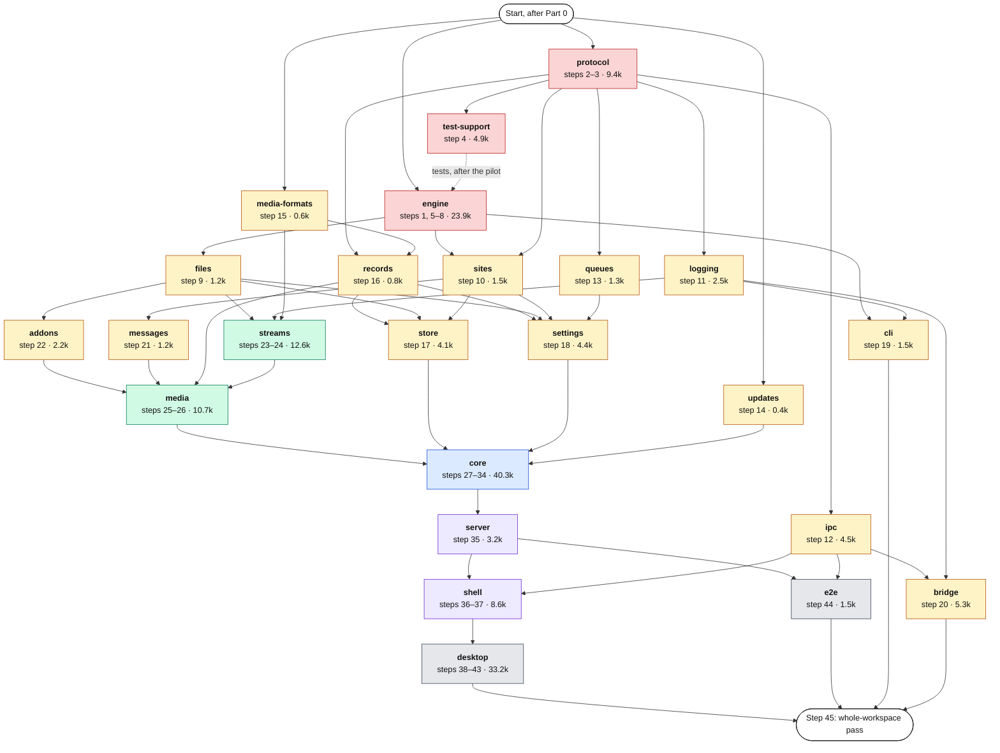
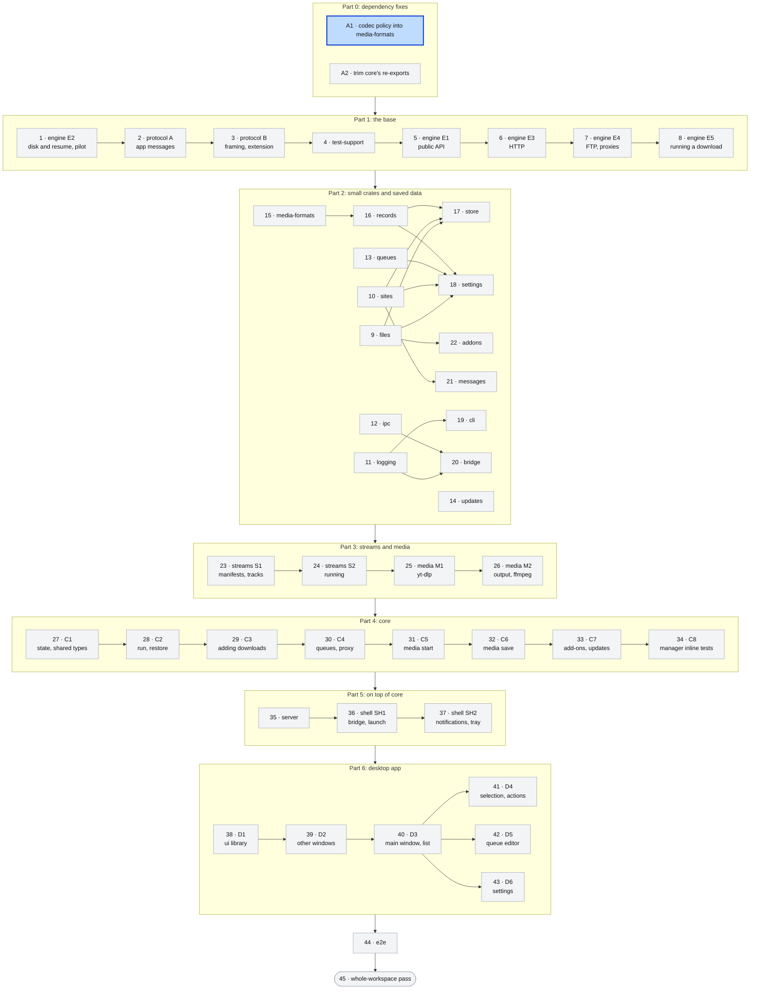

# Rust audit: order of work

The order for auditing `crates/` one chunk at a time, the `rust` scope of `docs/audit/AUDIT-PLAN.md`. Each chunk is reviewed, then every finding in it is fixed and merged, before the next chunk starts. The goal is less code and better code, with bugs fixed along the way.

Work starts with Part 0, then step 1. The step to work on is the one marked `now` in the progress diagram. Results go in `docs/audit/runs/<YYYY-MM>-rust/` (see AUDIT-PLAN, "Chunk by chunk").

Measured on `main` at `1cdd683`. Recount at the start, because the code will have moved.

## Why bottom-up, with a pilot first

A crate's public API is what the crates above it are built on. Auditing bottom-up means that when a chunk changes its API, the callers it breaks are code that has not been audited yet, and they get reviewed against the new API later. Top-down would do the opposite: every fix in a lower crate would reopen higher crates that were already finished.

The cost of bottom-up is that unused public API in a lower crate only shows once the code above it is cleaned. The close-out step at the end catches that.

One exception: step 1 is the engine's disk and resume code, the place where a defect loses data. It runs first as a pilot, so the riskiest code is reviewed first and the chunk size and the per-chunk loop are tested on it before 44 more steps follow. Its cost: the engine's public API (step 5) and `test-support` (step 4) are reviewed after it, so a change there can reopen step 1.

## Part 0: two dependency fixes before the audit

These change the dependency graph, so they land before step 1. The order below is built on the graph they leave. Each is one PR, in either order.

**A1. Move the codec policy into a new crate, `wirecatch-media-formats`.** `records` depends on `streams` for one import: `VideoCodec`, `AudioCodec` and `Container` from `streams::codec`. Those types cannot move alone: `Container::holds` and `Container::for_copy` take `Codec`, and the module also holds codec parsing, the subtitle check DASH uses, encoder targets, muxer names and fallbacks. So the whole of `streams/src/codec.rs` moves, with its tests (612 lines, `serde` its only dependency), into a new crate:

- `publish = false`, depends on `serde` only.
- `records`, `streams` and `media` depend on it. `records` no longer depends on `streams`, so the saved-data crates (`records`, `store`, `settings`) no longer pull in the stream downloader and can be audited before it.
- Not into `records`: that would make the crate for saved data own ffmpeg muxer rules, and give `streams` an edge to `protocol` through `records`.
- `records/src/media/output.rs` keeps its `pub use` of the three types, because its public fields use them. Every caller of `streams::codec` imports from the new crate in the same PR. No forwarding module is left in `streams`.
- Records a new decision amending D79 (a new crate) and D81.2 (where the codec types live). Adds a row to the layout table in `CLAUDE.md` and `AGENTS.md`.
- The saved shape must not change: the serde attributes and spellings stay as they are, and `cargo test -p wirecatch-store --test samples` must pass unchanged.

**A2. Trim `core`'s re-exports of lower crates.** `core/src/lib.rs` re-exports 24 items from `addons`, `records`, `settings` and `store`. `desktop`, `shell`, `e2e` and `core`'s own integration tests reach those crates through `core`, which hides their real dependencies and enlarges `core`'s API.

- Kept, because they appear in `core`'s own public types (manager config, results or `CoreError`): `KnownFolders`, `PathError`, `ComputerProxy`, `MediaAddonSources`, `Happened`, `SettingsFileError`, `StoreError`.
- The other 17 go: the add-on manifest names (`AddonComponent`, `AddonFile`, `ArchiveKind`, `ComponentId`, `Fingerprint`, `MEDIA_ADDON_FOLDER`, `ManifestError`, `PinnedKey`, `ReleaseFile`, `Sha256Digest`), `ActivityEvent`, `same_proxy`, `DEFAULT_QUEUE_ID`, `SettingsError`, `default_settings`, `DATABASE_FILE`, `DATABASE_SIDE_FILES`. Each user imports from the owning crate; `core`'s integration tests take it as a dev-dependency.
- `From<SettingsError> for CoreError` stays.
- It does not change the order, because `desktop`, `shell` and `e2e` come last either way.

Considered and dropped: moving `units`, `numeric` and `url` out of `engine` into a crate of their own. `sites` and `settings` also use `engine`'s network-guard and proxy types, and `store` reaches `engine` through `sites`, so only `files` and `addons` would leave the engine's tree. Too little for a second published crate and a change to D26.

## Crate map

The graph after Part 0. Read from top to bottom: an arrow means "audited before". Only direct links are drawn; a crate also depends on everything above it along the arrows. Each box gives the crate, its steps in the order and its size in lines, code and tests together. `product` is generated and left out.

Colours match the parts of the order: red is the base (Part 1), yellow the small crates and saved data (Part 2), green streams and media (Part 3), blue `core` (Part 4), purple what sits on `core` (Part 5), grey the desktop app and end-to-end tests (Part 6).

## Progress

Every step in the order, grouped by part. Inside a part, an arrow means "must be finished first"; the crate map shows the links between parts. The number is the order the chunks run in. To track the work, move an id from the `todo` line at the bottom to `done`, and the next one to `now`.

## The dependency graph today

Taken from `cargo metadata` (normal dependencies only, `wirecatch-` prefix dropped), before Part 0. The number of files that import each crate shows how far a change spreads.

| Crate          | Depends on                                                                                                                    | Used by (files importing it)                                                                                                                      |
| -------------- | ----------------------------------------------------------------------------------------------------------------------------- | ------------------------------------------------------------------------------------------------------------------------------------------------- |
| `product`      | nothing                                                                                                                       | 18 crates, plus `desktop`'s build script. Generated from `config/product.toml`, not audited                                                       |
| `protocol`     | nothing                                                                                                                       | core 73, desktop 58, shell 16, media 13, records 7, bridge 6, settings 5, and 9 more crates. Also the extension, through the generated TypeScript |
| `engine`       | nothing                                                                                                                       | core 59, streams 23, media 18, desktop 10, shell 6, and 8 more crates. Published on crates.io                                                     |
| `updates`      | nothing                                                                                                                       | core 1, shell 1                                                                                                                                   |
| `test-support` | product, protocol (both optional)                                                                                             | dev-dependency of 16 crates (engine 33 files, core 29, desktop 18, streams 9, shell 8, and more), normal dependency of `e2e`                      |
| `files`        | engine                                                                                                                        | core 18, media 2, settings 2, store 2, streams 2, addons 1, shell 1                                                                               |
| `sites`        | engine, protocol                                                                                                              | core 17, media 4, settings 2, store 2, desktop 1, messages 1                                                                                      |
| `logging`      | product, protocol                                                                                                             | core 7, streams 2, bridge 1, cli 1, desktop 1, shell 1                                                                                            |
| `ipc`          | product, protocol                                                                                                             | shell 7, e2e 4, bridge 3, desktop 2                                                                                                               |
| `queues`       | product, protocol                                                                                                             | core 4, desktop 3, settings 2                                                                                                                     |
| `messages`     | engine, product, protocol, sites                                                                                              | core 9, media 1                                                                                                                                   |
| `addons`       | engine, files, product                                                                                                        | core 11, media 1                                                                                                                                  |
| `streams`      | engine, files, logging, product                                                                                               | media 12, core 9, records 1                                                                                                                       |
| `records`      | product, protocol, streams                                                                                                    | core 11, media 3, store 2, settings 1                                                                                                             |
| `store`        | engine, files, product, protocol, records, sites                                                                              | core 9                                                                                                                                            |
| `settings`     | engine, files, product, protocol, queues, records, sites                                                                      | core 19, shell 1 (tests)                                                                                                                          |
| `media`        | addons, engine, files, messages, product, protocol, records, sites, streams                                                   | core 20, desktop 2                                                                                                                                |
| `core`         | addons, engine, files, logging, media, messages, product, protocol, queues, records, settings, sites, store, streams, updates | desktop 16, shell 11, e2e 3, server 1                                                                                                             |
| `server`       | core, engine, product, protocol                                                                                               | shell 2, e2e 1. Its protocol tests live in `core/tests/manager/protocol.rs` (D79.2)                                                               |
| `shell`        | core, engine, files, ipc, logging, product, protocol, server, updates                                                         | desktop 48                                                                                                                                        |
| `cli`          | engine, logging, product                                                                                                      | nothing                                                                                                                                           |
| `bridge`       | ipc, logging, product, protocol                                                                                               | nothing                                                                                                                                           |
| `desktop`      | core, engine, ipc, logging, media, product, protocol, queues, shell, sites                                                    | nothing                                                                                                                                           |
| `e2e`          | core, ipc, product, protocol, server, test-support                                                                            | nothing. Also runs the `bridge` binary, which its manifest does not show                                                                          |

What Part 0 changes:

| Crate           | Depends on after Part 0                        | Change                                                     |
| --------------- | ---------------------------------------------- | ---------------------------------------------------------- |
| `media-formats` | serde only                                     | new crate, holds `streams/src/codec.rs` and its tests (A1) |
| `records`       | product, protocol, media-formats               | no `streams` (A1)                                          |
| `streams`       | engine, files, logging, product, media-formats | takes the codec policy from the new crate (A1)             |
| `media`         | adds media-formats                             | direct imports of the codec policy (A1)                    |
| `desktop`       | adds the crates it used through `core`         | direct imports (A2)                                        |
| `shell`         | adds the crates it used through `core`         | direct imports (A2)                                        |
| `e2e`           | adds the crates it used through `core`         | direct imports (A2)                                        |

Two rules from `docs/DECISIONS.md` limit what a fix may do:

- `protocol` must never depend on `engine` (D26.4).
- The crate split itself is D79: each crate left `core` because it does not need the manager's state. Merging crates back needs a new decision.

## Size

About 177,500 lines of Rust in 437 reviewable files, before Part 0, counting examples and build scripts; the two generated files (`product/src/lib.rs`, `updates/src/installer_name.rs`) are not reviewed. The table counts code and tests separately. Inline tests are everything after the first `#[cfg(test)]` in a file, so the split is approximate; a chunk always takes a file whole.

| Crate          | Code   | Inline tests | `tests/` files |
| -------------- | ------ | ------------ | -------------- |
| `desktop`      | 26,898 | 6,281        | 0              |
| `core`         | 16,417 | 9,448        | 14,449         |
| `engine`       | 11,450 | 6,429        | 5,996          |
| `streams`      | 7,285  | 2,578        | 3,900          |
| `protocol`     | 6,638  | 2,818        | 0              |
| `media`        | 6,208  | 4,184        | 303            |
| `shell`        | 5,384  | 3,193        | 0              |
| `test-support` | 4,606  | 319          | 19             |
| `bridge`       | 2,560  | 2,062        | 710            |
| `ipc`          | 2,471  | 1,686        | 370            |
| `settings`     | 1,921  | 2,449        | 0              |
| `logging`      | 1,572  | 778          | 131            |
| `addons`       | 1,432  | 749          | 0              |
| `e2e`          | 941    | 0            | 550            |
| `files`        | 846    | 373          | 0              |
| `sites`        | 771    | 688          | 0              |
| `queues`       | 670    | 629          | 0              |
| `messages`     | 595    | 589          | 0              |
| `records`      | 590    | 170          | 0              |
| `server`       | 558    | 196          | 0              |
| `store`        | 470    | 3,511        | 160            |
| `cli`          | 396    | 164          | 940            |
| `updates`      | 261    | 163          | 0              |

A chunk holds at most about 8,000 lines, code and tests together (`docs/audit/AUDIT-PLAN.md`). Crates over that are split by job. Inside `engine`, `streams`, `core` and `desktop` the modules import each other in cycles, so a split cannot follow the import graph alone. Each split below keeps one job together, with the tests that exercise it.

## The order

Sizes are whole files, code plus tests, measured at `1cdd683` and rounded. "Waits for" names the steps that must be finished first. Ties between steps that wait for the same thing are broken by risk: the step where a defect hurts most goes first.

### Part 1: the base everything builds on

**1. `engine` E2: disk and resume, the pilot** (about 3,900 lines)
`storage`, `state`, `checkpoint`, `segment`, `writer`, `target`, `progress`, `segment/proptests.rs`, with `tests/expired_target.rs`.
Waits for Part 0. The highest-risk code in the product: corruption, lost progress and resume all live here. Before reading the files in full, write down the expected behaviour: claimed against written offsets, the order of a data write and its checkpoint, restart with matching, stale or invalid state, the final rename, and an occupied target. Read the engine's download entry and the worker's handoff to the writer only for orientation; they are reviewed in steps 5 and 8. At the end, check the pilot: did the chunk fit one session, which outside files were needed, where a claim stalled. Resize the later chunks if it did not fit.

**2. `protocol` A: the app's messages** (about 4,600 lines)
`lib.rs`, `app`, `desktop`, `rules`, `proxy`, `languages`, `media_start`.
Waits for Part 0. 16 crates and the extension use it: any change here spreads the furthest. A change means `pnpm protocol:generate` and checking the extension. `languages` is a data table and needs little review.

**3. `protocol` B: framing and the extension's messages** (about 4,900 lines)
`wire`, `frame`, `extension`, `page_read`, `shell`, `version`, `secret`, `secrets`, `hosts`, `exported`, `launch`.
Waits for 2, because `wire` and `exported` build on the `app` types.

**4. `test-support`** (about 4,900 lines)
Waits for 3. The tests of 16 crates and `e2e` use its servers. If it changed after those crates were done, their tests would have to be reopened. Only step 1 runs before it.

**5. `engine` E1: public API and shared helpers** (about 3,100 lines)
`lib.rs`, `error`, `units`, `numeric`, `url`, `naming`, `task`, `file_work`, `abandon`, `options`, with `tests/options.rs` and the shared `tests/common/`.
Waits for 4. Every other engine module uses these, and most crates use `units`, `numeric` and `url` (D26). This chunk holds the crates.io API, where removing a public item is a breaking release.

**6. `engine` E3: HTTP** (about 5,300 lines)
`http`, `http3`, `request`, `receive`, `host_pace`, `retry`, `transport`, with `tests/request_limit.rs`, `short_retry.rs`, `server_names.rs`, `network_failures.rs`, and `examples/bench_http3.rs`.
Waits for 1 and 5, because `http` writes through `segment` and `naming`.

**7. `engine` E4: FTP, proxies and network guards** (about 6,600 lines)
`ftp`, `proxy`, `socks`, `net_guard`, with `tests/ftp*.rs`, `proxy.rs`, `http_proxy_guard.rs`, `hardening.rs`.
Waits for 6, because `ftp` and `net_guard` reuse `http`'s request and error types. `sites` and `settings` use the guard and proxy types from here.

**8. `engine` E5: running a download** (about 5,000 lines)
`download`, `worker`, `fetch`, `limiter`, with `tests/download.rs`, `fetch.rs`, and `examples/bench_local.rs`.
Waits for 7. These modules call every other engine module, so they are judged last, against cleaned parts.

### Part 2: small crates and saved data

**9. `files`** (1,200). Waits for 8. File writes that 7 crates share. A defect here corrupts files.
**10. `sites`** (1,500). Waits for 3 and 8. Which links may reach the local network (D39, D44): a security rule.
**11. `logging`** (2,500). Waits for 3. Secret redaction (D40).
**12. `ipc`** (4,500). Waits for 3. The local endpoint the bridge and the app talk through.
**13. `queues`** (1,300). Waits for 3. Pure functions with good tests, so lower risk.
**14. `updates`** (400). Waits for nothing. Small and low in logic. `src/installer_name.rs` is generated.
**15. `media-formats`** (600). Waits for nothing. The codec and container rules that `records`, `streams` and `media` share. A change to a serialized name breaks saved downloads (D81).
**16. `records`** (800). Waits for 3 and 15. The saved format (D81): a change here needs new samples in `crates/store/samples`.
**17. `store`** (4,100). Waits for 9, 10 and 16. The SQLite download list and its repair (D17).
**18. `settings`** (4,400). Waits for 9, 10, 13 and 16.
**19. `cli`** (1,500). Waits for 8 and 11. Nothing depends on it, so it goes as soon as its dependencies are done.
**20. `bridge`** (5,300). Waits for 11 and 12. Takes untrusted input from the browser. Nothing depends on it.
**21. `messages`** (1,200). Waits for 10. What a person is told when a download fails (D3).
**22. `addons`** (2,200). Waits for 9. Checksums, signatures and unpacking archives (D20, D21): security.

### Part 3: streams and media

**23. `streams` S1: reading manifests and choosing tracks** (about 7,000)
`lib.rs`, `hls`, `dash`, `model`, `plan`, `select`, `source`, `track_id`, with `tests/hls.rs`, `dash.rs`, `manifest_memory.rs`, `master_playlist_work.rs` and the shared `tests/common/`.
Waits for 9, 11 and 15. Parses outside input, so panics and unbounded memory matter here.

**24. `streams` S2: running a stream download** (about 6,100)
`download`, `process`, `ffmpeg`, `workdir`, `crypto`, `extension`, `error`, with `tests/process.rs`, `ffmpeg.rs`, and the fake programs in `examples/` those tests run.
Waits for 23.

**25. `media` M1: yt-dlp and page reading** (about 4,400)
`ytdlp`, `phantomjs`, `tools`, the `phantomjs` binary, with `tests/phantomjs.rs`.
Waits for 16, 21, 22 and 24. Runs outside programs on outside input.

**26. `media` M2: output, quality choice and ffmpeg** (about 6,300)
`lib.rs`, `output`, `choice`, `describe`, `convert`, `ffmpeg`, `merge`.
Waits for 25.

### Part 4: `core`, the download manager

`core` comes after all 15 crates it depends on, so its review can see what it repeats from them. Tests in `core/tests/manager/` go with the code they test. The order follows which manager modules the others call.

**27. C1: manager state and shared types** (about 7,100)
`lib.rs`, `manager/mod.rs`, `state`, `options`, `policy`, `questions`, `handovers`, `private_sessions`, and the crate's top-level `error`, `naming`, `batches`, `headers`, `clock`, `speed`, `proxy`, with `tests/manager/lifecycle.rs`, `common.rs`, `main.rs`, and `examples/headless.rs`.
Waits for 26, and with it every crate `core` depends on. Every other manager module reads `state`. Checks that A2 left only the re-exports `core`'s own types need.

**28. C2: running and restoring downloads** (about 5,500)
`run`, `settle`, `fake`, `ticker`, `restore`, `relocate`, `startup`, `failure_log`, with `tests/manager/restart.rs`, `settle.rs`, `fault_kill.rs`, `ftp.rs`, `again.rs`.
Waits for 27. `downloads`, `file_exists` and `restore` call `run`.

**29. C3: adding downloads** (about 5,900)
`captures`, `arrival`, `placement`, `added_pages`, `downloads`, `file_exists`, `file_type`, `refresh`, `page_reads`, `page_readings`, `sign_in`, `browser`, with `tests/manager/file_exists.rs`, `file_type.rs`, `windows.rs`.
Waits for 28.

**30. C4: queues, preferences and proxy** (about 3,900)
`queues`, `scheduling`, `preferences`, `manager/proxy`, `suffix_list`, with `tests/manager/queues.rs`, `schedule.rs`, `rules.rs`, `limits.rs`, `proxy.rs`, `settings.rs`, `settings_file.rs`.
Waits for 29. `queues` calls `downloads`.

**31. C5: starting a media download** (about 6,800)
`media.rs`, `media_run/` (`mod`, `page`, `network`, `extras`), `bin/fake_media_tool.rs`, with `tests/manager/media_support.rs` and all of `tests/manager/media.rs`.
Waits for 30. `media` calls `captures`, `downloads` and `refresh`. `media.rs` (3,100 lines) also has tests that run through saving, restart and add-ons; it stays whole here, and each such test is checked against the contract of step 32, 28 or 33.

**32. C6: saving a media download** (about 2,600)
`media_run/` (`save`, `placement`, `workdir`, `tests.rs`), with `tests/manager/media_output.rs`.
Waits for 31.

**33. C7: add-on installs and app updates** (about 4,200)
`manager/addons/`, `app_update.rs`, `app_update/`, with `tests/manager/addons.rs` and `examples/media_tool_release.rs`.
Waits for 32. `addons` calls into `media` and `state`.

**34. C8: the manager's inline tests** (about 2,000)
`manager/tests.rs`, one file of tests for C1 to C7. Reviewed whole, once their code is settled, instead of being split seven ways. Each test is checked against the contract of the step whose code it drives.
Waits for 33.

### Part 5: what sits on `core`

**35. `server`** (about 3,200, with `core/tests/manager/protocol.rs`). Waits for 34. Serves one client connection from the manager (D14). The protocol tests live in `core`'s `manager` test target (D79.2) but test what `server` serves, so they are reviewed here.

**36. `shell` SH1: bridge serving, launch and system** (about 4,600)
`api`, `host`, `bridge`, `launch`, `autostart`, `appimage`, `elevation`, `quit`, `message_box`, `updates`.
Waits for 12, 14 and 35.

**37. `shell` SH2: notifications and tray** (about 4,000)
`notifications`, `system_notifications`, `browser_notices`, `teller`, `activity`, `finished`, `download_windows`, `tray`, `tray_*`, `appearance`.
Waits for 36.

### Part 6: the desktop app

Nothing depends on `desktop`, so a change here never spreads. It goes last because it calls `core`, `shell`, `media` and `queues`, which must be settled first. Screens draw only through `ui/`, so that goes first.

**38. D1: component library and basics** (about 6,600)
`ui`, `text`, `theme`, `rows`, `links`, `files`, `backend`, `closing`, `lifecycle`, `main`, `build`, `sign_in`.
Waits for 37.

**39. D2: windows outside the main window** (about 7,300)
`download_windows`, `add_dialog`, `library`, `notices`, `tray`, `app_update`.
Waits for 38.

**40. D3: main window frame and list** (about 7,100)
`main_window/` `mod`, `list`, `laid`, `sidebar`, `rail`, `title_bar`, `command_bar`, `empty`, `sort`, `order`, `drag`, `notices_bar`, `leaving`, `keymap`, `palette`.
Waits for 39.

**41. D4: selection and row actions** (about 4,400)
`selection`, `details`, `row_menu`, `applies`, `confirm`, `fixes`, `refresh_window`, `link_trial`, `backup_dialog`.
Waits for 40.

**42. D5: queue editor** (about 4,000)
`queue_editor`, `queue_rules`, `queue_proxy`, `queue_header`, `queue_delete`, `proxy_dialog`.
Waits for 40.

**43. D6: settings window** (about 3,900)
`main_window/settings/`.
Waits for 40.

**44. `e2e`** (1,500). Waits for everything. Tests the extension, bridge and app together, so it is checked against the final code.

### Close-out

**45. Whole-workspace pass.**

- Run the unused-public-item check and `jscpd` over `crates/` again. Code that became dead or duplicate because of later steps goes back to its crate as one more fix.
- Empty the cross-chunk queue (below): every entry is fixed or closed with a reason.
- Run the download-and-resume and media-to-file flows end to end on the final tree.

## Each chunk, step by step

1. **Facts first.** Coverage, mutation testing on its risky files, and `jscpd` and unused-public-item hits for its files. These are leads, not findings.
   - Unused public items: the `unreachable_pub` lint plus a search for callers. Neither proves an `engine` item has no callers outside the workspace (D26).
   - A mutation that times out counts as caught only when a failing test confirms it.
   - Coverage of `streams` needs its fake programs built first, or its process tests fail and the numbers are wrong.
2. **Review** the whole chunk against `docs/ENGINEERING.md`, reading every file in full.
3. **Check each finding** before fixing it: against the code, an existing test, or a new failing test. Drop what does not hold.
4. **Fix** every confirmed finding in the chunk before moving on. A change to a public item updates every caller in the same PR, so `main` always builds. Check with `cargo check --workspace` and the tests of each crate the PR touches. A change to `engine`'s public API also runs the `engine-docs`, `engine-package` and `msrv` gate checks.
5. **Write down its contract:** what other crates may rely on, in one page. Later chunks judge their callers against it.
6. **Merge**, then start the next chunk.

A later chunk may change an earlier crate in two cases only: it moves duplicate code down into that crate, or it deletes API it no longer needs. That change goes in the later chunk's PR, with the earlier crate's tests run.

**Cross-chunk queue.** A finding whose fix belongs in a crate the audit has not reached yet goes into the run's `QUEUE.md`, with the crate, the evidence and the step that found it. It is fixed when that crate's chunk runs, so the current chunk can close without waiting. Step 45 empties whatever is left.

## Assumptions

- Chunk sizes come from line counts and module imports, not from reading the code. Recount a chunk's files when it starts.
- The A2 lists hold at `1cdd683`. Recheck them against `core/src/lib.rs` when A2 starts.
